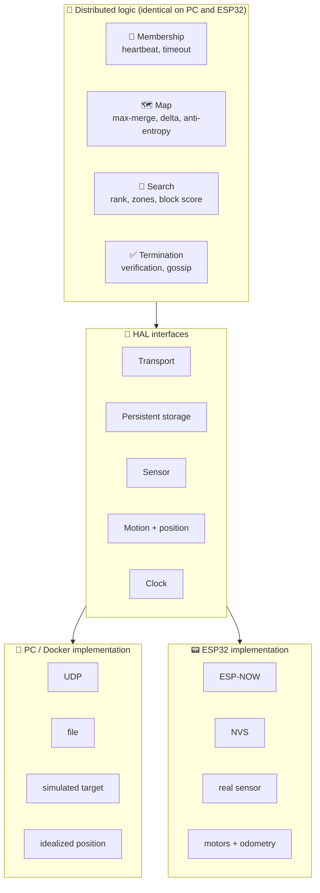
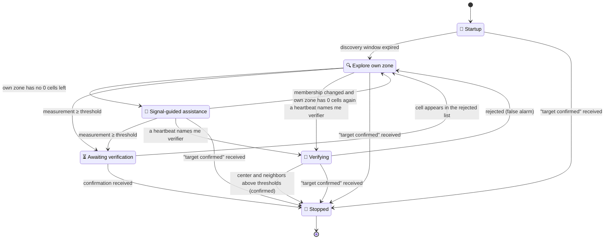
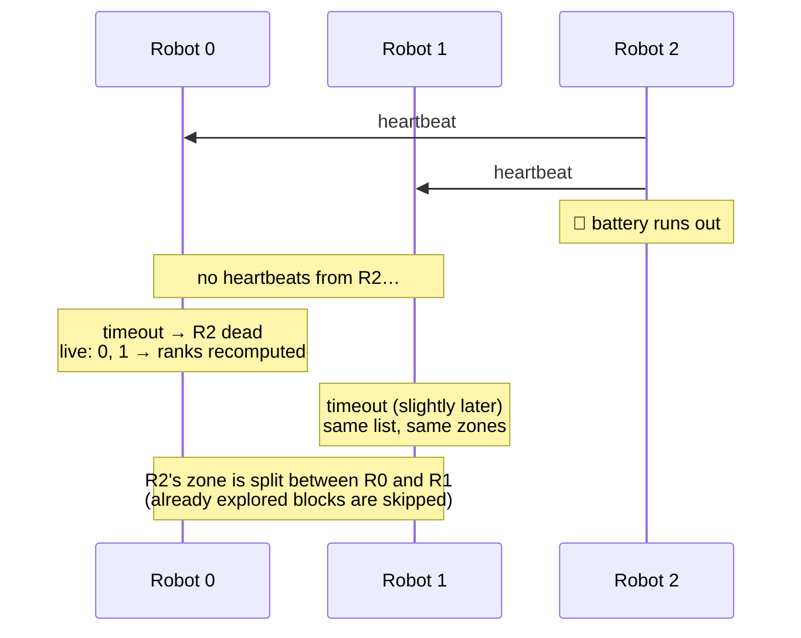
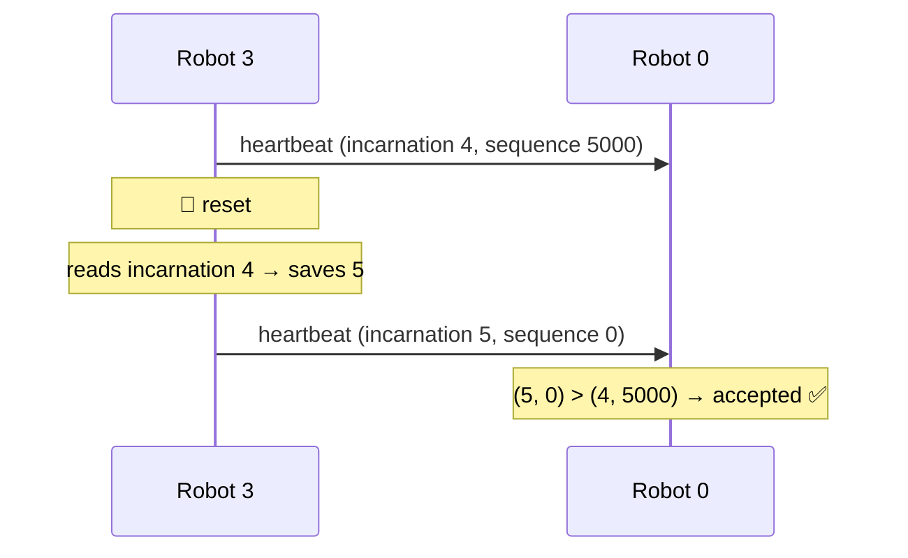
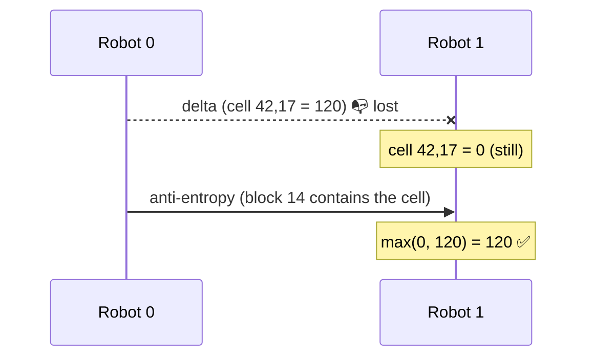
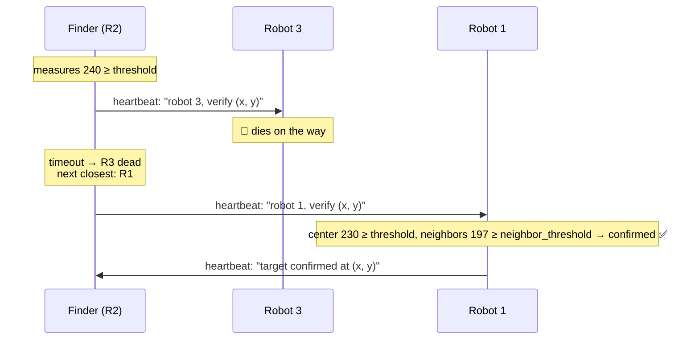
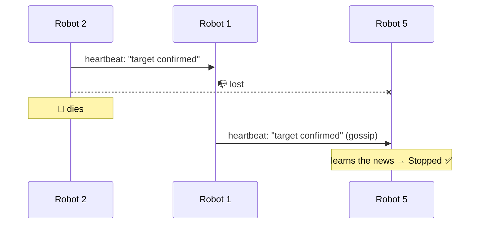

🇬🇧 **English** · [🇷🇴 Română](DESIGN.ro.md)

# 🤖 Robot Swarm – Design Document

> A distributed system of autonomous robots searching together for a common target.
>
> **Status:** draft · **Platform:** ESP32 + ESP-NOW · **Simulation:** Docker · **Language:** C++

---

## Contents

1. [Purpose and context](#1-purpose-and-context)
2. [Assumptions and limitations](#2-assumptions-and-limitations)
3. [Fault model](#3-fault-model)
4. [Architecture](#4-architecture)
5. [Robot behavior](#5-robot-behavior)
6. [Local state](#6-local-state)
7. [Messages](#7-messages)
8. [Decision rules](#8-decision-rules)
9. [Failure scenarios](#9-failure-scenarios)
10. [Configurable parameters](#10-configurable-parameters)
11. [Open questions](#11-open-questions)

---

## 1. Purpose and context

The project implements a **distributed system of autonomous robots** that
search together, as fast as possible, for a target located in a room. The
target is a **static** source of a weak signal, and the search space is a room
of at most **10 × 10 m**.

The system is **fully decentralized**: there is no leader or central
coordinator. Each robot chooses its next action on its own, based on the
information exchanged with the others. To coordinate the search, the robots
jointly build a **shared map of the signal intensity** across the room.

| | |
|--|--|
| 🎯 **Target** | weak signal source, static |
| 📐 **Space** | room of at most 10 × 10 m |
| 🕸️ **Architecture** | fully decentralized, no coordinator |
| 🗺️ **Coordination** | shared map, synchronized between robots |

---

## 2. Assumptions and limitations

The assumptions below narrow the problem so that the work can focus on the
distributed part: communication, membership, map replication and leaderless
coordination.

### Assumptions

| Assumption | Why |
|--|--|
| 📐 The room is at most **10 × 10 m** | ESP-NOW covers the whole room, so every robot hears all the others directly (*single-hop*), with no routing |
| 🎯 The target is **static** | The map is merged with `max`, which only grows. If the target moved, the old values around it would remain forever |
| 🧭 Robots start from **known positions**, with the same orientation and the origin in a corner of the room | All robots share one coordinate system without negotiating it. A map cell means the same thing to every robot |
| 🛞 Positioning and movement are **idealized** in simulation | They are not part of the distributed problem. They sit behind an interface (HAL) and can later be replaced with real implementations |
| 📡 Each robot has a **sensor** that measures signal intensity | The algorithm only depends on one numeric value per cell. The exact target type (light or RF) does not change the logic |

### Limitations

- **Map resolution** is 10 cm per cell, so the map (100 × 100 cells × 1 B = 10 KB) fits in ESP32 memory.
- **Noise peaks** are kept forever by `max`. An alternative, to be evaluated experimentally: average + counter per cell.
- **Unreachable cells** (e.g. under an obstacle) stay `0`, so the zone containing them never looks finished.
- **Obstacles and collisions** between robots are not handled.
- **In the assistance phase**, a robot may enter a zone whose owner is still working there. Already explored cells are skipped, so little work is lost, but the risk of collision grows.
- **Shared coordinates** are a simplification. The general problem, where robots build their own maps and align them, is called *collaborative SLAM* and is out of scope.

## 3. Fault model

The fault model states **what can go wrong** and, therefore, what the system
must tolerate. Anything not listed here is considered out of scope.

### Communication channel

Robots communicate through **ESP-NOW broadcast, without acknowledgements (ACK)**. On this channel a message can be:

| Fault | Example | How it is handled |
|--|--|--|
| 📭 **lost** | a heartbeat does not reach a robot | timeout after **several** missing heartbeats; anti-entropy retransmits the map; important state is repeated periodically in the heartbeat |
| 👯 **duplicated** | the same map delta arrives twice | merging with `max` is **idempotent**: `max(v, v) = v` |
| 🔀 **reordered** | an old heartbeat arrives after a newer one | the (incarnation, sequence) rule: messages older than the last accepted one are ignored |
| ~~💥 corrupted~~ | — | **does not occur**: 802.11 frames carry a hardware-checked CRC-32, UDP has a checksum |

### Robots

| Fault | Example | How it is handled |
|--|--|--|
| 🪫 **permanent stop** (*crash-stop*) | the battery runs out | peers declare it dead after the timeout and **re-divide the zones** |
| 🔄 **restart** (*crash-recovery*) | a reset loses everything in RAM | the **incarnation number**, kept in non-volatile memory, grows at each boot; peers know the sequence restarted from zero |
| 📈 **sensor reporting false values** | a noise peak or a faulty sensor | **local filter** (repeated measurements, trimmed mean); the target is confirmed only after an **independent measurement** by another robot; after *k* rejections in a row the robot **retires on its own** |

### Time

- **There is no global clock.** Robot clocks are not synchronized.
- The local clock is used only for **durations** (heartbeat period, timeout).
- The order of messages from one sender is given by the **(incarnation, sequence)** pair, not by a timestamp.

### Out of scope

- **Malicious robots** (*Byzantine faults*): a robot that deliberately lies or sends messages on behalf of another.
- **Network partitions:** in a 10 × 10 m room all robots hear each other directly (see section 2). Message loss can still cause **false suspicions** (a live robot declared dead); these are repaired at the next received heartbeat.

## 4. Architecture

The same logic code must run in two places: on a **PC, in Docker** (several
virtual robots) and on the **ESP32**. The system is therefore split into two
layers:

- **distributed logic**: identical everywhere, unaware of the hardware it runs on;
- **HAL** (*Hardware Abstraction Layer*): a set of interfaces with one
  implementation per platform.



### Logic components

| Component | Responsibility | Uses |
|--|--|--|
| 💓 **Membership** | keeps the table of live robots; sends and receives heartbeats; declares robots dead after the timeout | Transport, Clock, Storage (incarnation) |
| 🗺️ **Map** | keeps the local map; merges it with `max`; sends deltas and anti-entropy blocks | Transport |
| 🧩 **Search** | computes the rank and own zone; picks the next block to explore | Membership, Map, Motion, Sensor |
| ✅ **Termination** | triggers verification at the threshold; picks the verifier; spreads the confirmation | Membership, Map, Sensor |

### HAL interfaces

| Interface | PC / Docker | ESP32 |
|--|--|--|
| **Transport** | UDP broadcast | ESP-NOW broadcast |
| **Persistent storage** | file | NVS (non-volatile storage) |
| **Sensor** | value computed from a simulated target | real sensor |
| **Motion + position** | idealized position | motors + odometry *(to be decided)* |
| **Clock** | system clock | ESP32 timer |

**Dependency rule:** the logic depends only on interfaces, never on a concrete
implementation. This way, the behavior validated in simulation is exactly the
one that runs on the board.

## 5. Robot behavior

Each robot is a **state machine**. All robots run the same machine; only the
data differs (ID, position, what they heard from the others).



### Background activities (in every state)

Regardless of state, each robot:

- sends its **heartbeat** periodically, with its position and relevant state (verification request, "target confirmed");
- receives messages, updates the **membership table** and declares robots dead after the timeout;
- merges the received map with `max` and sends **deltas** and **anti-entropy** blocks;
- recomputes its **rank** when the list of live robots changes.

### 5.1 Startup and discovery

1. Reads the **incarnation number** from persistent storage, increments it and saves it **before** sending the first message.
2. Starts the sequence number at 0.
3. Sends heartbeats and listens for a **discovery window** to fill its membership table.
4. At the end of the window it computes its rank and zone, then starts exploring.

> A robot that boots later joins the same flow: peers discover it through its heartbeat and the zones are re-divided.

### 5.2 Exploring the own zone

1. Own zone = the strip of blocks given by the rank (see [section 8](#8-decision-rules)).
2. The robot walks through the zone's blocks and **skips cells already explored** (value ≠ 0 in the shared map).
3. In each cell it measures the signal and writes it to the map; the new cell goes into the next delta.
4. If membership changes, the zone is recomputed on the spot.

### 5.3 Signal-guided assistance

When the own zone has no `0` cells left:

1. Candidates = blocks anywhere in the room that **still have `0` cells**.
2. Score = **average of the explored cells** in the block (excluding `0`).
3. Robots that have finished (inferred from the map, with no extra messages) are ordered by rank
   and take the candidates in turn, starting from the highest score.

### 5.4 Target verification

**Local filter (in every cell, for every robot):** the robot measures several times (e.g. 3),
**drops the highest value** and averages the rest (*trimmed mean*; alternative: the median).
The filtered value is the one written to the map and compared with the threshold. A transient noise
peak thus reaches neither the map nor a verification request:

```
noise: 240, 35, 32   → (35 + 32) / 2   = 33.5   → below threshold, nothing to verify
real:  240, 228, 235 → (228 + 235) / 2 = 231.5  → above threshold, request verification
```

**The robot that finds** a filtered value ≥ threshold, in a cell that is **not** in the list of rejected cells (the *finder*):

1. **does not declare the target on its own** (safety);
2. picks the closest live robot, based on heartbeats, as **verifier**;
3. puts the request "robot K, verify cell (x, y)" in its heartbeat and repeats it until it gets an answer;
4. if K dies (timeout), picks the next closest live robot.

**The verifier**:

1. goes to cell (x, y) and independently measures **the center and its 8 neighbors** (each with the local filter);
2. applies the confirmation rule (a real target has a **gradient**: the signal is high around it too; a noise peak is isolated):

   ```
   confirmed = center ≥ threshold  AND  neighbor average ≥ neighbor_threshold
   ```

   | | Center | Neighbor average | Result (threshold 200, neighbor_threshold 100) |
   |--|--:|--:|--|
   | noise | 230 | 31 | rejected |
   | target | 230 | 197.5 | confirmed |

   > The condition "center ≥ neighbor average" is **not** enough: a noise peak is always higher than its neighbors.

3. **confirmed** → enters Stopped and starts announcing the confirmation;
4. **rejected** → false alarm; adds the cell to the list of rejected cells and returns to exploring.

**Rejected cells:** a rejected cell is added to a **list of rejected cells**, announced in the heartbeat and
spread by gossip, like "target confirmed". Its map value cannot be lowered (`max`), but it is
**ignored when computing scores** (assistance phase). The list only grows (set union), so it is also a **CRDT**.

**Faulty sensor – retirement:** a faulty sensor passes the local filter (it always reads high). A robot that
receives **k rejections in a row** considers its sensor faulty and **retires on its own**: it stops and no longer
sends heartbeats. Peers declare it dead through the timeout and re-divide its zone. No vote is needed.

> *Limitations:* false values already written by a faulty sensor remain in the map; a **verifier** with a faulty
> sensor may reject the real target. The system trusts each robot's measurements; a complete defense belongs to
> Byzantine faults (out of scope).

### 5.5 Stopping

- A robot enters Stopped when it **confirms** the target or **learns** about the confirmation.
- It keeps sending heartbeats with "target confirmed at (x, y)", so the news reaches everyone (*gossip*).
- The "confirmed" state is never undone (`false → true`), so duplicates and reordering cannot break it.

## 6. Local state

Each robot keeps **only** the information below in memory. There is no shared
state other than what is replicated through messages.

### Identity

| Field | Size | Source |
|--|--:|--|
| ID | 1 B | configured at setup, unique per robot |
| incarnation | 2 B | read from persistent storage, incremented at each boot |
| current sequence | 4 B | starts at 0, grows with every message sent (any type) |

### Membership table

One entry per robot heard:

| Field | Used for |
|--|--|
| last incarnation + last sequence | the "new message" rule (see [section 7](#7-messages)) |
| position (x, y) | choosing the verifier (the closest one) |
| time of last message (local clock) | timeout → robot declared dead |
| state announced in the heartbeat | verification requests, rejected cells, "target confirmed" |

The table yields the **list of live robots**, sorted by ID → the robot's own **rank**.

### Map

- a grid of **100 × 100 cells** of 10 cm, **1 B** per cell → **10 KB**;
- `0` = unexplored, `1–255` = signal intensity (quantized);
- a measurement of `0` is stored as `1`: `value = max(1, measured)`. Otherwise the cell would look unexplored forever.
  Only the difference between 0 and 1 is lost, which is irrelevant for finding the target (at high values);
- divided into **100 blocks** of 10 × 10 cells, indexed 0–99 in **serpentine** order
  (see [8.2](#82-own-zone-contiguous-strips)): `by = i / 10`; `bx = i % 10` on even rows, `bx = 9 − i % 10` on odd rows;
- the list of new cells not yet sent (the next **delta**).

> *Implementation note:* anti-entropy needs to know quickly whether a block is empty. A counter of non-zero
> cells per block (100 × 1 B) avoids scanning all 100 cells at every cycle.

### Behavior state

- the current state of the state machine ([section 5](#5-robot-behavior));
- rank, own zone, current block;
- if finder: the found cell and the chosen verifier;
- if verifier: the cell to verify;
- "target confirmed" + cell (never undone);
- the **list of rejected cells** (only grows);
- the number of consecutive rejections of its own requests (for retirement).

**Memory budget:** the map (10 KB) dominates; the rest is a few hundred bytes. Everything fits easily in the ESP32's ~320 KB of RAM.

## 7. Messages

A message fits into an ESP-NOW payload of **at most 250 B** and has the form
**common header (8 B) + body** (depends on the type).

### Common header

| Field | Size | Why |
|--|--:|--|
| message type | 1 B | the receiver knows how to read the body; room for new types |
| sender ID | 1 B | the row in the membership table (logical ID, not MAC: compact, also works in simulation) |
| incarnation | 2 B | grows at every restart; 1 B would require manually erasing non-volatile memory on overflow |
| sequence number | 4 B | detects loss and reordering; 2 B would wrap after ~73 min at 15 messages/s, 4 B after ~9 years |
| **Total** | **8 B** | |

**"New message" rule** (lexicographic order): a message from robot R is accepted if
`incarnation > last incarnation` **or** (`incarnation = last incarnation` **and** `sequence > last sequence`).
Otherwise it is ignored. Map data from old messages can still be merged with `max`, at no risk.

### Message types

#### 💓 Heartbeat

| Field | Size | When present |
|--|--:|--|
| position (x, y) | 2 B | always (in cells, 0–99) |
| flags | 1 B | always; tell which of the fields below follow |
| verification request: verifier ID + cell | 3 B | if the robot is a finder |
| target confirmed: cell | 2 B | after confirmation (forever) |
| rejected cells: count *n* + *n* cells | 1 + 2*n* B | if the list is not empty (gossip) |

Without the list: at most **8 + 8 = 16 B**. The list fits up to `(250 − 16 − 1) / 2 = 116` cells.
The finder learns that its request was rejected when the cell appears in the verifier's list; no separate "false alarm" field is needed.

The robot's block is not sent: it is computed from the position (`x / 10`, `y / 10`).

> *Proposed format; fields and their order may be adjusted during implementation.*

#### 🧩 Map delta

- a list of cells `(x, y, value)`, **3 B** each;
- at most `(250 − 8) / 3 = 80` cells per message;
- the number of cells is derived from the message length.

#### 🔁 Anti-entropy

- **2 blocks** per message: `2 × (block ID 1 B + 100 B data) = 202 B` → `8 + 202 = 210 B ≤ 250` ✅;
- only **non-empty blocks** are sent (an all-`0` block changes nothing under `max`);
- one message every 200 ms → a full cycle takes from **0.6 s** (6 non-empty blocks) to **10 s** (full map);
- usually repairs a lost delta within one cycle; if the anti-entropy message is lost too, in the next cycle.

## 8. Decision rules

All decisions are **deterministic**: the same input yields the same decision
on any robot. This is how robots agree **without a coordinator**.

### 8.1 Rank

1. The list of live robots (including the robot itself) is sorted by ascending ID.
2. **Rank** = the robot's position in that list (0, 1, 2, ...).

| Live robots | ID 0 | ID 1 | ID 3 | ID 5 |
|--|:-:|:-:|:-:|:-:|
| **Rank** | 0 | 1 | 2 | 3 |

> Why rank and not ID? With raw IDs, after robot 2 dies some blocks would be left without an owner.
> Rank is always contiguous (0 … N−1).

The rank is **not sent** over the network: each robot recomputes it locally whenever the list of live robots changes.

### 8.2 Own zone (contiguous strips)

With **N** live robots and **100** blocks:

```
blocks_per_robot = 100 / N             (integer division)
start(rank)      = rank × blocks_per_robot
end(rank)        = start + blocks_per_robot − 1
the last rank (N−1) also takes the remainder: end = 99
```

| N | Ranks 0 … N−2 | Last rank |
|--:|--|--|
| 3 | 33 blocks | 33 + **1** = 34 (includes block 99) |
| 7 | 14 blocks | 14 + **2** = 16 |

- Contiguous strips keep neighboring blocks together → **shorter travel** than an interleaved split (`block % N`).
- Blocks are numbered in **serpentine** order (*boustrophedon*), so that blocks *i* and *i + 1* are always neighbors.
  With row-by-row numbering, the robot would cross the whole room back at the end of each row:

  ```
  row by row             serpentine
  0 → 1 → 2              0 → 1 → 2
  3 → 4 → 5    ✗         5 ← 4 ← 3   ✓
  6 → 7 → 8              6 → 7 → 8
  ```
- The remainder (`100 % N`, at most N − 1 blocks) goes to the last rank, next to its strip.
- Already explored blocks are skipped, so a re-division does not repeat finished work.

### 8.3 Who has finished

The robot with rank *r* has finished if **its zone has no `0` cells left**.

- This is inferred from the map, **with no extra messages**.
- It does not matter who explored the zone.

### 8.4 Choosing a block in the assistance phase

1. **Candidates** = blocks that still have `0` cells.
2. **Score** = average of the **explored** cells in the block. `0` cells are excluded: they mean *unexplored*, not *zero signal*.
   Cells **rejected** at verification are excluded too (see [5.4](#54-target-verification)).

   | Block | Explored cells | Average with `0` | Average without `0` |
   |--|--|--:|--:|
   | X | 10 × 50, remaining 90 × `0` | 5 | **50** |
   | Y | 100 × 10 | 10 | **10** |

   A block **with no explored cells** would have an average of `0 / 0`. It gets the **average of the whole explored map**
   ("we know nothing → assume an ordinary block"). It thus comes after the promising blocks, but before those
   known to be weak:

   | Block | Explored cells | Score |
   |--|--|--:|
   | A | 20, average 10 | 10 |
   | B | 5, average 60 | 60 |
   | C | 0 | map average: `(20 × 10 + 5 × 60) / 25 = 20` |

   → order **B, C, A**.

3. Candidates are sorted by **descending score**.
4. Robots that have finished are ordered by rank. The *k*-th of them takes candidate *k*.

> *Proposal:* if more robots have finished than there are candidates, the list wraps around
> (two robots on the same block). This is acceptable near the end of the search.

### 8.5 Choosing the verifier

The finder picks the **closest live robot**, using the positions from heartbeats.

- **A single robot** decides (the finder), so there is no disagreement. If every robot decided on its own
  from slightly stale positions, two verifiers might come, or **none**.
- If the verifier dies (timeout), the finder picks the next closest one.

### 8.6 Tie-breaking

Determinism also requires rules for ties, otherwise two robots may choose differently:

| Situation | Rule |
|--|--|
| two blocks with the same score | the block with the **lower index** wins |
| two robots at the same distance | the robot with the **lower ID** wins |

## 9. Failure scenarios

These scenarios show how the system behaves when the faults from
[section 3](#3-fault-model) occur. Each one becomes a **simulation test**.

### 9.1 A robot dies while exploring



- Between the two timeouts, R0 and R1 have different lists → blocks temporarily **duplicated** or **unassigned**.
- The disagreement disappears once both have declared the timeout (**eventual consistency**).

### 9.2 A robot restarts



Without the incarnation, `0 < 5000` → the new messages would be ignored and R3 would be declared dead while working.

### 9.3 A map delta is lost



The loss is usually repaired within one anti-entropy cycle (0.6–10 s).

### 9.4 The verifier dies on the way



### 9.5 The confirmation is lost, then the announcer dies



The news does not depend on the robot that announced it: anyone who knows it retransmits it.

## 10. Configurable parameters

Concrete values are **not fixed now**: they are chosen through measurements in simulation (evaluation chapter).

| Parameter | What it controls | Trade-off |
|--|--|--|
| ⏱️ heartbeat period | how often a robot announces it is alive | frequent → fast detection, but more radio traffic |
| ⌛ timeout | after how many missing heartbeats a robot is declared dead | small → fast reaction, but more **false suspicions** |
| 🔍 discovery window | how long a robot listens at startup | short → fast startup, but it may miss some robots |
| 🔁 anti-entropy interval | how often an anti-entropy message is sent (currently 200 ms) | frequent → fast repair, but occupies the channel |
| 🎯 signal threshold | the value that triggers a verification request | low → false alarms; high → the target may be missed |
| 🔂 measurements per cell | how many measurements go into the local filter | many → better filter, but slower exploration |
| 🚫 *k* rejections | after how many consecutive rejections a robot retires | small → good robots retired by bad luck; large → a faulty sensor causes more disruption |
| 🎯 neighbor threshold | minimum neighbor average for confirmation (e.g. threshold / 2) | low → noise passes; high → a weak target is rejected |
| 🗺️ map resolution | the size of a cell (currently 10 cm) | fine → more precise, but more memory |

### Experiment ideas

- anti-entropy cycle duration as a function of the explored percentage;
- time to find the target as a function of the number of robots;
- behavior when 1, 2, … robots die during the search;
- `max` vs. average + counter per cell, in the presence of noise.

## 11. Open questions

| Question | Details |
|--|--|
| 🧭 target type | light source or RF emitter (ESP32 beacon, RSSI)? |
| 🛞 locomotion and localization | chassis, motors, encoders, IMU, odometry; idealized in simulation |
| 🚧 obstacles and collisions | avoiding obstacles and the other robots |
| ⬛ unreachable cells | stay `0` → their zone never looks finished |
| 🌍 map fully explored without confirmation | what does the swarm do when nothing is left to explore and the target was not found? |
| 👥 two simultaneous finders | two robots exceed the threshold in different cells at the same time |
| 📏 zones moving on re-division | strips can shift a lot; a robot may be sent far away |
| 🛑 behavior when Stopped | stay in place or move toward the target? |
| 🛠️ ESP32 framework | ESP-IDF or Arduino; PlatformIO or idf.py |
| 📡 multi-hop | artificially limited range in simulation, for experiments |
