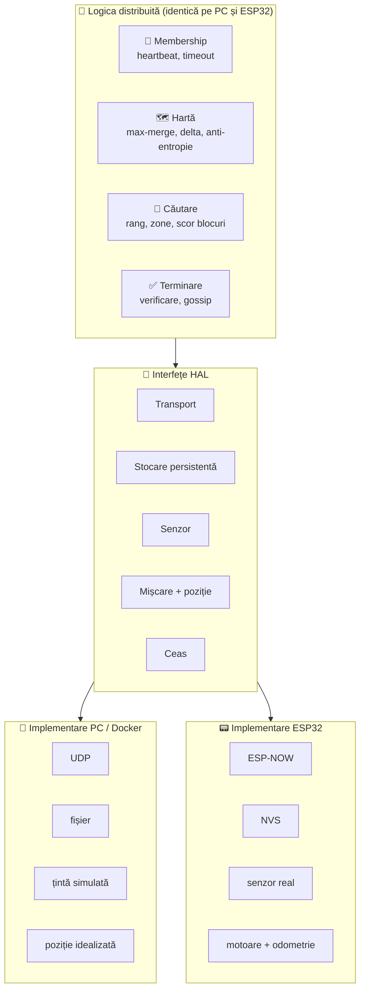
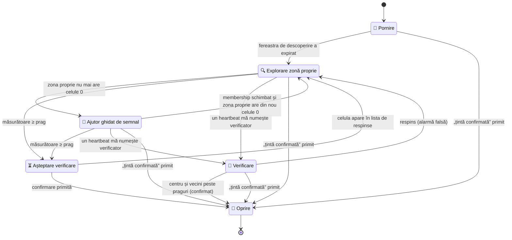
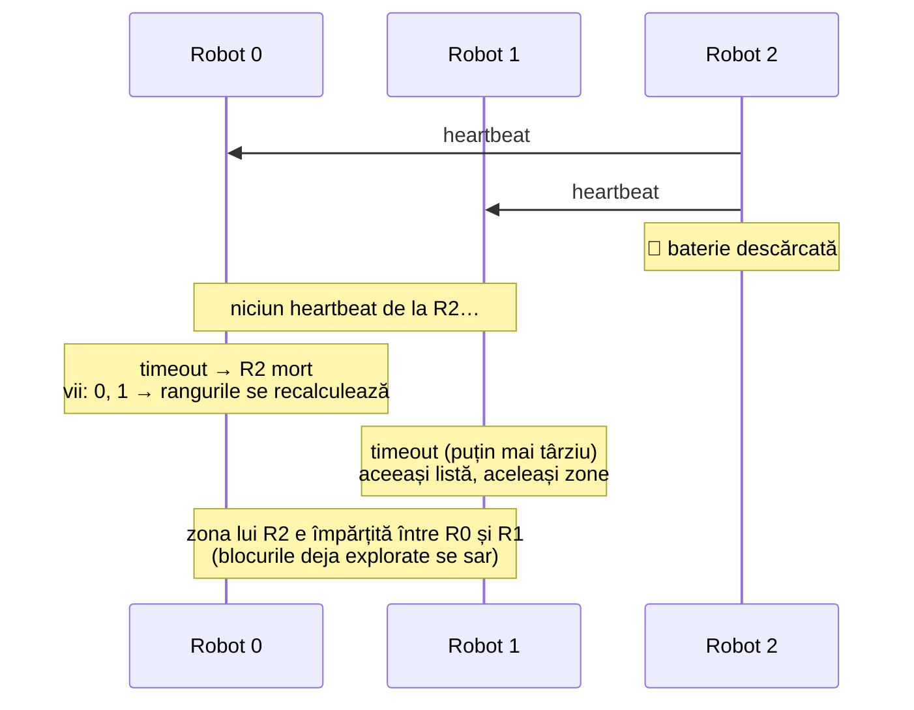
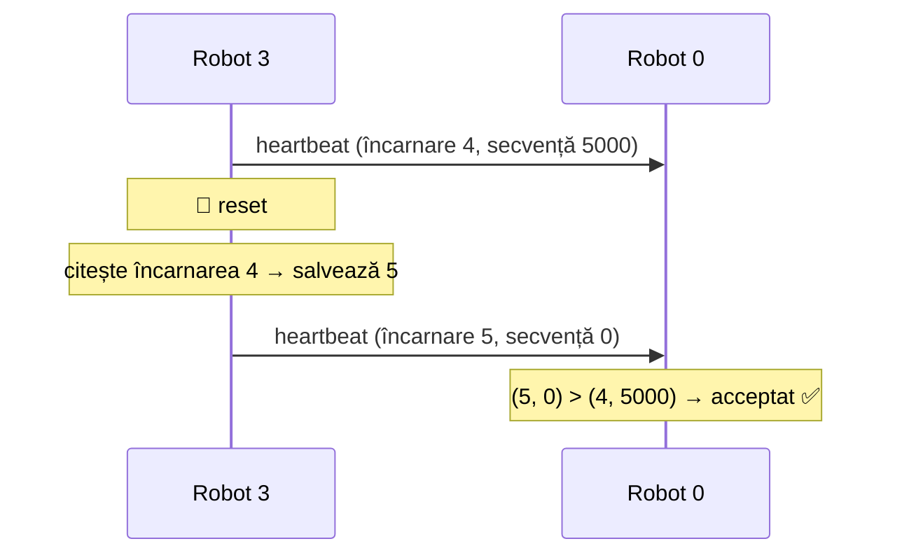
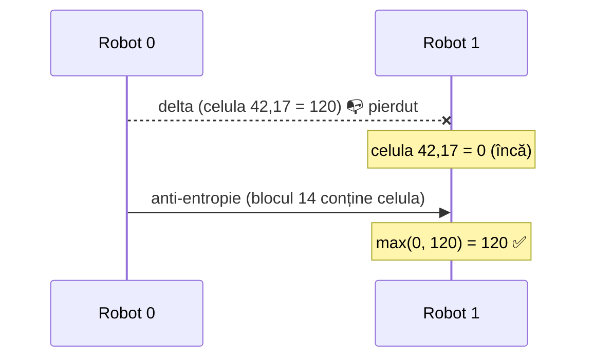
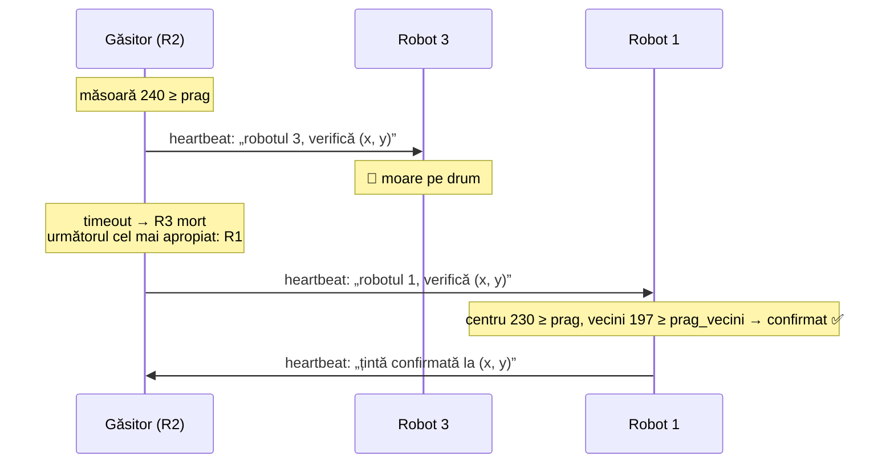
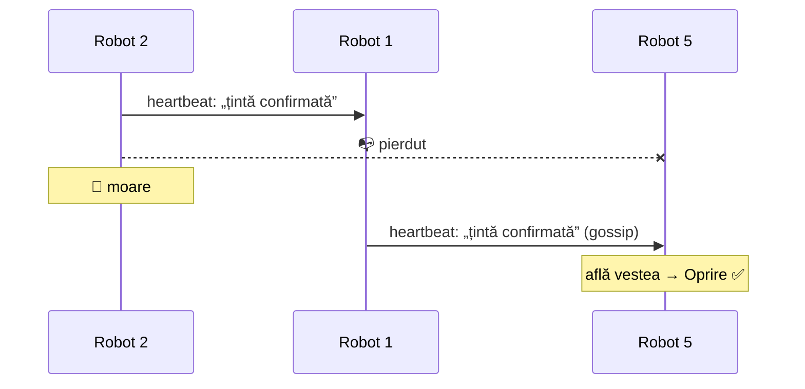

[🇬🇧 English](DESIGN.md) · 🇷🇴 **Română**

# 🤖 Robot Swarm – Document de proiectare

> Sistem distribuit de roboți autonomi care caută împreună o țintă comună.
>
> **Stare:** în redactare · **Platformă:** ESP32 + ESP-NOW · **Simulare:** Docker · **Limbaj:** C++

---

## Cuprins

1. [Scop și context](#1-scop-și-context)
2. [Presupuneri și limitări](#2-presupuneri-și-limitări)
3. [Modelul de defecte](#3-modelul-de-defecte)
4. [Arhitectura](#4-arhitectura)
5. [Comportamentul unui robot](#5-comportamentul-unui-robot)
6. [Starea locală](#6-starea-locală)
7. [Mesaje](#7-mesaje)
8. [Reguli de decizie](#8-reguli-de-decizie)
9. [Scenarii de defect](#9-scenarii-de-defect)
10. [Parametri configurabili](#10-parametri-configurabili)
11. [Probleme deschise](#11-probleme-deschise)

---

## 1. Scop și context

Proiectul implementează un **sistem distribuit de roboți autonomi** care caută
împreună, cât mai rapid, o țintă aflată într-o încăpere. Ținta este o sursă
**statică** de semnal slab, iar spațiul de căutare este o cameră de cel mult
**10 × 10 m**.

Sistemul este **complet descentralizat**: nu există un lider sau un coordonator
central. Fiecare robot își alege singur următoarea acțiune, pe baza
informațiilor schimbate cu ceilalți. Pentru a coordona căutarea, roboții
construiesc împreună o **hartă comună a intensității semnalului** în cameră.

| | |
|--|--|
| 🎯 **Țintă** | sursă de semnal slab, statică |
| 📐 **Spațiu** | cameră de cel mult 10 × 10 m |
| 🕸️ **Arhitectură** | complet descentralizată, fără coordonator |
| 🗺️ **Coordonare** | hartă comună, sincronizată între roboți |

<!-- TODO (student): paragraful despre accentul pe sisteme distribuite, problemele și platforma -->

---

## 2. Presupuneri și limitări

Presupunerile de mai jos restrâng problema, astfel încât lucrarea să se poată
concentra pe partea distribuită: comunicare, membership, replicarea hărții și
coordonarea fără lider.

### Presupuneri

| Presupunere | De ce |
|--|--|
| 📐 Camera are cel mult **10 × 10 m** | ESP-NOW acoperă toată camera, deci fiecare robot îi aude direct pe toți ceilalți (*single-hop*), fără rutare |
| 🎯 Ținta este **statică** | Harta se combină cu `max`, care doar crește. Dacă ținta s-ar muta, valorile vechi din jurul ei ar rămâne pentru totdeauna |
| 🧭 Roboții pornesc din **poziții cunoscute**, cu aceeași orientare, cu originea într-un colț al camerei | Toți folosesc același sistem de coordonate, fără să-l negocieze. Celulele hărții înseamnă același lucru pentru fiecare robot |
| 🛞 Poziționarea și deplasarea sunt **idealizate** în simulare | Nu țin de partea distribuită. Sunt ascunse în spatele unei interfețe (HAL) și pot fi înlocuite ulterior cu implementări reale |
| 📡 Fiecare robot are un **senzor** care măsoară intensitatea semnalului | Algoritmul depinde doar de o valoare numerică per celulă. Tipul exact al țintei (lumină sau RF) nu schimbă logica |

### Limitări

- **Rezoluția hărții** este de 10 cm per celulă, ca harta (100 × 100 celule × 1 B = 10 KB) să încapă în memoria ESP32.
- **Vârfurile de zgomot** sunt păstrate pentru totdeauna de `max`. O alternativă, de evaluat experimental: medie + contor per celulă.
- **Celulele inaccesibile** (de exemplu sub un obstacol) rămân `0`, deci zona care le conține nu pare niciodată terminată.
- **Obstacolele și coliziunile** dintre roboți nu sunt tratate.
- **În faza de ajutor**, un robot poate intra în zona în care lucrează încă proprietarul ei. Celulele deja explorate se sar, deci se pierde doar puțină muncă, dar crește riscul de coliziune.
- **Coordonatele comune** sunt o simplificare. Problema generală, în care roboții își construiesc singuri hărți și le aliniază, se numește *SLAM colaborativ* și iese din scopul lucrării.

## 3. Modelul de defecte

Modelul de defecte spune **ce poate merge prost** și, implicit, ce trebuie să
tolereze sistemul. Tot ce nu apare aici este considerat în afara scopului.

### Canalul de comunicație

Roboții comunică prin **broadcast ESP-NOW, fără confirmări (ACK)**. Pe acest canal, un mesaj poate fi:

| Defect | Exemplu | Cum e tratat |
|--|--|--|
| 📭 **pierdut** | un heartbeat nu ajunge la un robot | timeout după **mai multe** heartbeat-uri lipsă; anti-entropia retransmite harta; starea importantă e repetată periodic în heartbeat |
| 👯 **duplicat** | același delta de hartă sosește de două ori | combinarea cu `max` este **idempotentă**: `max(v, v) = v` |
| 🔀 **reordonat** | un heartbeat vechi sosește după unul nou | regula (încarnare, secvență): mesajele mai vechi decât ultimul acceptat sunt ignorate |
| ~~💥 corupt~~ | — | **nu apare**: cadrele 802.11 au CRC-32 verificat în hardware, UDP are checksum |

### Roboții

| Defect | Exemplu | Cum e tratat |
|--|--|--|
| 🪫 **oprire definitivă** (*crash-stop*) | se descarcă bateria | colegii îl declară mort după timeout și **reîmpart zonele** |
| 🔄 **repornire** (*crash-recovery*) | un reset pierde tot ce era în RAM | **numărul de încarnare**, păstrat în memorie nevolatilă, crește la fiecare pornire; colegii știu că secvența a pornit de la zero |
| 📈 **senzor care raportează valori false** | un vârf de zgomot sau un senzor defect | **filtru local** (măsurători repetate, medie trunchiată); ținta e confirmată doar după o **măsurătoare independentă** a altui robot; după *k* respingeri la rând robotul **se retrage singur** |

### Timpul

- **Nu există un ceas global.** Ceasurile roboților nu sunt sincronizate.
- Ceasul local se folosește doar pentru **durate** (perioada heartbeat-ului, timeout-ul).
- Ordinea mesajelor de la un expeditor se stabilește prin perechea **(încarnare, secvență)**, nu prin timestamp.

### În afara scopului

- **Roboți rău-intenționați** (*defecte bizantine*): un robot care minte deliberat sau trimite mesaje false în numele altuia.
- **Partiții de rețea:** în camera de 10 × 10 m toți roboții se aud direct (vezi secțiunea 2). Pierderile de mesaje pot produce totuși **suspiciuni false** (un robot viu declarat mort); acestea se repară la următorul heartbeat primit.

## 4. Arhitectura

Același cod de logică trebuie să ruleze în două locuri: pe **PC, în Docker**
(mai mulți roboți virtuali) și pe **ESP32**. De aceea sistemul e împărțit în
două straturi:

- **logica distribuită**: identică peste tot, nu știe pe ce hardware rulează;
- **HAL** (*Hardware Abstraction Layer*): un set de interfețe cu câte o
  implementare pentru fiecare platformă.



### Componentele logicii

| Componentă | Responsabilitate | Folosește |
|--|--|--|
| 💓 **Membership** | ține tabelul de roboți vii; trimite și primește heartbeat-uri; declară roboții morți după timeout | Transport, Ceas, Stocare (încarnarea) |
| 🗺️ **Hartă** | ține harta locală; o combină cu `max`; trimite delta-uri și blocuri de anti-entropie | Transport |
| 🧩 **Căutare** | calculează rangul și zona proprie; alege următorul bloc de explorat | Membership, Hartă, Mișcare, Senzor |
| ✅ **Terminare** | declanșează verificarea la prag; alege verificatorul; răspândește confirmarea | Membership, Hartă, Senzor |

### Interfețele HAL

| Interfață | PC / Docker | ESP32 |
|--|--|--|
| **Transport** | UDP broadcast | ESP-NOW broadcast |
| **Stocare persistentă** | fișier | NVS (memorie nevolatilă) |
| **Senzor** | valoare calculată dintr-o țintă simulată | senzor real |
| **Mișcare + poziție** | poziție idealizată | motoare + odometrie *(de stabilit)* |
| **Ceas** | ceasul sistemului | timer-ul ESP32 |

**Regula de dependență:** logica depinde doar de interfețe, niciodată de o
implementare concretă. Astfel, comportamentul validat în simulare este exact
cel care rulează pe placă.

## 5. Comportamentul unui robot

Fiecare robot este o **mașină de stări**. Toți roboții rulează aceeași mașină;
diferă doar datele (ID, poziție, ce au auzit de la ceilalți).



### Activități de fundal (în orice stare)

Indiferent de stare, fiecare robot:

- trimite **heartbeat-ul** periodic, cu poziția și starea relevantă (cerere de verificare, „țintă confirmată”);
- primește mesaje, actualizează **tabelul de membership** și declară roboții morți după timeout;
- combină harta primită cu `max` și trimite **delta-uri** și blocuri de **anti-entropie**;
- recalculează **rangul** când lista de roboți vii se schimbă.

### 5.1 Pornire și descoperire

1. Citește **numărul de încarnare** din stocarea persistentă, îl crește cu 1 și îl salvează **înainte** de a trimite primul mesaj.
2. Pornește secvența de la 0.
3. Trimite heartbeat-uri și ascultă o **fereastră de descoperire**, ca să-și completeze tabelul de membership.
4. La finalul ferestrei își calculează rangul și zona, apoi trece la explorare.

> Un robot care pornește mai târziu intră direct în același flux: colegii îl descoperă din heartbeat, iar zonele se reîmpart.

### 5.2 Explorarea zonei proprii

1. Zona proprie = fâșia de blocuri dată de rang (vezi [secțiunea 8](#8-reguli-de-decizie)).
2. Robotul parcurge blocurile zonei și **sare peste celulele deja explorate** (valoare ≠ 0 în harta comună).
3. În fiecare celulă măsoară semnalul și îl scrie în hartă; celula nouă intră în următorul delta.
4. Dacă membership-ul se schimbă, zona se recalculează pe loc.

### 5.3 Ajutor ghidat de semnal

Când zona proprie nu mai are celule `0`:

1. Candidate = blocurile din toată camera care **mai au celule `0`**.
2. Scor = **media celulelor explorate** din bloc (fără `0`).
3. Roboții care au terminat (deduși din hartă, fără mesaje în plus) se ordonează după rang
   și iau pe rând candidatele, de la scorul cel mai mare.

### 5.4 Verificarea țintei

**Filtrul local (în fiecare celulă, pentru orice robot):** robotul măsoară de mai multe ori (de ex. 3),
**elimină valoarea cea mai mare** și face media celorlalte (*medie trunchiată*; alternativă: mediana).
Valoarea filtrată este cea scrisă în hartă și comparată cu pragul. Un vârf de zgomot trecător nu ajunge
astfel nici în hartă, nici la o cerere de verificare:

```
zgomot: 240, 35, 32   → (35 + 32) / 2   = 33,5   → sub prag, nimic de verificat
real:   240, 228, 235 → (228 + 235) / 2 = 231,5  → peste prag, cere verificare
```

**Robotul care găsește** o valoare filtrată ≥ prag, într-o celulă care **nu** e în lista de celule respinse (*găsitorul*):

1. **nu declară singur ținta** (safety);
2. alege din heartbeat-uri cel mai apropiat robot viu ca **verificator**;
3. pune în heartbeat cererea „robotul K, verifică celula (x, y)” și o repetă până la răspuns;
4. dacă K moare (timeout), alege următorul cel mai apropiat robot viu.

**Verificatorul**:

1. merge la celula (x, y) și măsoară independent **centrul și cei 8 vecini** (fiecare cu filtrul local);
2. aplică regula de confirmare (o țintă reală are **gradient**: semnalul e mare și în jurul ei; un vârf de zgomot e izolat):

   ```
   confirmat = centrul ≥ prag  ȘI  media vecinilor ≥ prag_vecini
   ```

   | | Centru | Media vecinilor | Rezultat (prag 200, prag_vecini 100) |
   |--|--:|--:|--|
   | zgomot | 230 | 31 | respins |
   | țintă | 230 | 197,5 | confirmat |

   > Condiția „centrul ≥ media vecinilor” **nu** ajunge: un vârf de zgomot e mereu mai mare decât vecinii lui.

3. **confirmat** → trece în Oprire și începe să anunțe confirmarea;
4. **respins** → alarmă falsă; adaugă celula în lista de celule respinse și revine la explorare.

**Celule respinse:** o celulă respinsă intră într-o **listă de celule respinse**, anunțată în heartbeat și
răspândită prin gossip, ca „țintă confirmată”. Valoarea ei din hartă nu poate fi coborâtă (`max`), dar
**este ignorată la calculul scorului** (faza de ajutor). Lista doar crește (reuniune de mulțimi), deci este tot un **CRDT**.

**Senzor defect – retragere:** un senzor defect trece de filtrul local (dă mereu valori mari). Un robot care
primește **k respingeri la rând** își consideră senzorul defect și **se retrage singur**: se oprește și nu mai
trimite heartbeat-uri. Colegii îl declară mort prin timeout și îi reîmpart zona. Nu este nevoie de vot.

> *Limitări:* valorile false scrise deja de un senzor defect rămân în hartă; un **verificator** cu senzor defect
> poate respinge ținta reală. Sistemul are încredere în măsurătorile fiecărui robot; apărarea completă ține de
> defectele bizantine (în afara scopului).

### 5.5 Oprire

- Un robot intră în Oprire când **confirmă** ținta sau când **află** de confirmare.
- Continuă să trimită heartbeat-uri cu „țintă confirmată la (x, y)”, ca vestea să ajungă la toți (*gossip*).
- Starea „confirmat” nu se mai anulează niciodată (`false → true`), deci duplicatele și reordonarea nu o pot strica.

## 6. Starea locală

Fiecare robot ține în memorie **doar** informațiile de mai jos. Nu există stare
comună în afara celor replicate prin mesaje.

### Identitate

| Câmp | Dim. | Sursa |
|--|--:|--|
| ID | 1 B | configurat la instalare, unic per robot |
| încarnare | 2 B | citită din stocarea persistentă, crescută la fiecare pornire |
| secvență curentă | 4 B | pornește de la 0, crește la fiecare mesaj trimis (orice tip) |

### Tabelul de membership

O intrare pentru fiecare robot auzit:

| Câmp | Folosit pentru |
|--|--|
| ultima încarnare + ultima secvență | regula „mesaj nou” (vezi [secțiunea 7](#7-mesaje)) |
| poziție (x, y) | alegerea verificatorului (cel mai apropiat) |
| momentul ultimului mesaj (ceas local) | timeout → robot declarat mort |
| starea anunțată în heartbeat | cereri de verificare, celule respinse, „țintă confirmată” |

Din tabel se obține **lista de roboți vii**, sortată după ID → **rangul** propriu.

### Harta

- grilă de **100 × 100 celule** de 10 cm, câte **1 B** per celulă → **10 KB**;
- `0` = neexplorat, `1–255` = intensitatea semnalului (cuantizată);
- o măsurătoare de `0` se scrie ca `1`: `valoare = max(1, măsurat)`. Altfel celula ar părea neexplorată pentru totdeauna.
  Se pierde doar diferența dintre 0 și 1, irelevantă pentru găsirea țintei (care e la valori mari);
- împărțită în **100 de blocuri** de 10 × 10 celule, cu indice 0–99 numerotat **în serpentină**
  (vezi [8.2](#82-zona-proprie-fâșii-continue)): `by = i / 10`; `bx = i % 10` pe rândurile pare, `bx = 9 − i % 10` pe cele impare;
- lista celulelor noi, încă netrimise (următorul **delta**).

> *Notă de implementare:* pentru anti-entropie trebuie aflat repede dacă un bloc e gol. Un contor de celule
> nenule per bloc (100 × 1 B) evită parcurgerea celor 100 de celule la fiecare ciclu.

### Starea comportamentului

- starea curentă din mașina de stări ([secțiunea 5](#5-comportamentul-unui-robot));
- rangul, zona proprie, blocul curent;
- dacă e găsitor: celula găsită și verificatorul ales;
- dacă e verificator: celula de verificat;
- „țintă confirmată” + celula (nu se mai anulează);
- **lista de celule respinse** (doar crește);
- numărul de respingeri la rând ale propriilor cereri (pentru retragere).

**Buget de memorie:** harta (10 KB) domină; restul are câteva sute de bytes. Totul încape ușor în ~320 KB RAM ai ESP32.

## 7. Mesaje

Un mesaj încape într-un payload ESP-NOW de **cel mult 250 B** și are forma
**header comun (8 B) + corp** (depinde de tip).

### Header comun

| Câmp | Dim. | De ce |
|--|--:|--|
| tip mesaj | 1 B | receptorul știe cum să citească corpul; loc pentru tipuri noi |
| ID expeditor | 1 B | linia din tabelul de membership (ID logic, nu MAC: compact, merge și în simulare) |
| încarnare | 2 B | crește la fiecare restart; 1 B ar cere ștergerea manuală a memoriei nevolatile la depășire |
| nr. secvență | 4 B | detectează pierderi și reordonare; 2 B s-ar reseta după ~73 min la 15 mesaje/s, 4 B după ~9 ani |
| **Total** | **8 B** | |

**Regula „mesaj nou”** (ordine lexicografică): un mesaj de la robotul R este acceptat dacă
`încarnare > ultima încarnare` **sau** (`încarnare = ultima încarnare` **și** `secvență > ultima secvență`).
Altfel e ignorat. Datele de hartă din mesajele vechi pot fi combinate oricum cu `max`, fără risc.

### Tipuri de mesaje

#### 💓 Heartbeat

| Câmp | Dim. | Când e prezent |
|--|--:|--|
| poziție (x, y) | 2 B | mereu (în celule, 0–99) |
| flag-uri | 1 B | mereu; spun care dintre câmpurile de mai jos urmează |
| cerere de verificare: ID verificator + celulă | 3 B | dacă robotul e găsitor |
| țintă confirmată: celulă | 2 B | după confirmare (pentru totdeauna) |
| celule respinse: număr *n* + *n* celule | 1 + 2*n* B | dacă lista nu e goală (gossip) |

Fără listă: maxim **8 + 8 = 16 B**. Lista încape pentru cel mult `(250 − 16 − 1) / 2 = 116` celule.
Găsitorul află că cererea lui a fost respinsă când celula apare în lista verificatorului; nu e nevoie de un câmp separat de „alarmă falsă”.

Blocul în care se află robotul nu se trimite: se calculează din poziție (`x / 10`, `y / 10`).

> *Propunere de format; câmpurile și ordinea lor se pot ajusta la implementare.*

#### 🧩 Delta de hartă

- listă de celule `(x, y, valoare)`, câte **3 B** fiecare;
- cel mult `(250 − 8) / 3 = 80` de celule per mesaj;
- numărul de celule se deduce din lungimea mesajului.

#### 🔁 Anti-entropie

- **2 blocuri** per mesaj: `2 × (ID bloc 1 B + 100 B date) = 202 B` → `8 + 202 = 210 B ≤ 250` ✅;
- se trimit **doar blocurile nevide** (un bloc plin de `0` nu schimbă nimic la `max`);
- un mesaj la 200 ms → ciclul complet durează de la **0,6 s** (6 blocuri nevide) la **10 s** (harta plină);
- repară un delta pierdut de obicei într-un ciclu; dacă se pierde și mesajul de anti-entropie, în ciclul următor.

## 8. Reguli de decizie

Toate deciziile sunt **deterministe**: aceleași date de intrare dau aceeași
decizie pe orice robot. Așa ajung roboții la acord **fără coordonator**.

### 8.1 Rangul

1. Lista de roboți vii (inclusiv robotul însuși) se sortează crescător după ID.
2. **Rangul** = poziția robotului în listă (0, 1, 2, ...).

| Roboți vii | ID 0 | ID 1 | ID 3 | ID 5 |
|--|:-:|:-:|:-:|:-:|
| **Rang** | 0 | 1 | 2 | 3 |

> De ce rang și nu ID? Cu ID-uri brute, după moartea robotului 2 ar rămâne blocuri fără proprietar.
> Rangul este mereu continuu (0 … N−1).

Rangul **nu se trimite** pe rețea: fiecare robot îl recalculează local când se schimbă lista de roboți vii.

### 8.2 Zona proprie (fâșii continue)

Cu **N** roboți vii și **100** de blocuri:

```
blocuri_per_robot = 100 / N            (împărțire întreagă)
început(rang)     = rang × blocuri_per_robot
sfârșit(rang)     = început + blocuri_per_robot − 1
ultimul rang (N−1) ia și restul: sfârșit = 99
```

| N | Rangurile 0 … N−2 | Ultimul rang |
|--:|--|--|
| 3 | 33 de blocuri | 33 + **1** = 34 (include blocul 99) |
| 7 | 14 blocuri | 14 + **2** = 16 |

- Fâșiile continue țin blocurile vecine împreună → **drum mai scurt** decât o împărțire alternată (`bloc % N`).
- Blocurile sunt numerotate **în serpentină** (*boustrophedon*), ca blocul *i* și *i + 1* să fie mereu vecine.
  Cu numerotarea rând cu rând, de la capătul fiecărui rând robotul ar traversa toată camera înapoi:

  ```
  rând cu rând           în serpentină
  0 → 1 → 2              0 → 1 → 2
  3 → 4 → 5    ✗         5 ← 4 ← 3   ✓
  6 → 7 → 8              6 → 7 → 8
  ```
- Restul (`100 % N`, cel mult N − 1 blocuri) ajunge la ultimul rang, lângă fâșia lui.
- Blocurile deja explorate se sar, deci o reîmpărțire nu repetă munca făcută.

### 8.3 Cine a terminat

Robotul cu rangul *r* a terminat dacă **zona lui nu mai are nicio celulă `0`**.

- Se deduce din hartă, **fără mesaje în plus**.
- Nu contează cine a explorat zona.

### 8.4 Alegerea blocului în faza de ajutor

1. **Candidate** = blocurile care mai au celule `0`.
2. **Scor** = media celulelor **explorate** din bloc. Celulele `0` sunt excluse: înseamnă *neexplorat*, nu *semnal zero*.
   Sunt excluse și **celulele respinse** la verificare (vezi [5.4](#54-verificarea-țintei)).

   | Bloc | Celule explorate | Media cu `0` | Media fără `0` |
   |--|--|--:|--:|
   | X | 10 × 50, restul 90 × `0` | 5 | **50** |
   | Y | 100 × 10 | 10 | **10** |

   Un bloc **fără nicio celulă explorată** ar avea media `0 / 0`. Primește **media întregii hărți explorate**
   („nu știm nimic → presupunem un bloc obișnuit”). Astfel ajunge după blocurile promițătoare, dar înaintea celor
   cunoscute ca slabe:

   | Bloc | Celule explorate | Scor |
   |--|--|--:|
   | A | 20, media 10 | 10 |
   | B | 5, media 60 | 60 |
   | C | 0 | media hărții: `(20 × 10 + 5 × 60) / 25 = 20` |

   → ordinea **B, C, A**.

3. Candidatele se sortează **descrescător după scor**.
4. Roboții care au terminat se ordonează după rang. Al *k*-lea dintre ei ia candidata *k*.

> *Propunere:* dacă sunt mai mulți roboți care au terminat decât candidate, se reia lista de la început
> (doi roboți pe același bloc). La sfârșitul căutării este acceptabil.

### 8.5 Alegerea verificatorului

Găsitorul alege **cel mai apropiat robot viu**, folosind pozițiile din heartbeat-uri.

- Decide **un singur robot** (găsitorul), deci nu există dezacord. Dacă fiecare robot ar decide singur pe
  baza unor poziții ușor învechite, ar putea veni doi verificatori sau **niciunul**.
- Dacă verificatorul moare (timeout), găsitorul îl alege pe următorul cel mai apropiat.

### 8.6 Departajarea egalităților

Determinismul cere și reguli pentru egalități, altfel doi roboți pot alege diferit:

| Situație | Regula |
|--|--|
| două blocuri cu același scor | câștigă blocul cu **indicele mai mic** |
| doi roboți la aceeași distanță | câștigă robotul cu **ID-ul mai mic** |

## 9. Scenarii de defect

Scenariile arată cum se comportă sistemul când apar defectele din
[secțiunea 3](#3-modelul-de-defecte). Fiecare devine un **test în simulare**.

### 9.1 Un robot moare în timpul explorării



- Între cele două timeout-uri, R0 și R1 au liste diferite → blocuri temporar **dublate** sau **neluate**.
- Dezacordul dispare singur când ambii declară timeout-ul (**consistență eventuală**).

### 9.2 Un robot repornește



Fără încarnare, `0 < 5000` → mesajele noi ar fi ignorate și R3 ar fi declarat mort deși funcționează.

### 9.3 Un delta de hartă se pierde



Pierderea e reparată de obicei într-un ciclu de anti-entropie (0,6–10 s).

### 9.4 Verificatorul moare pe drum



### 9.5 Confirmarea se pierde, apoi anunțătorul moare



Vestea nu depinde de robotul care a anunțat-o: oricine o știe o retransmite.

## 10. Parametri configurabili

Valorile concrete **nu se fixează acum**: se aleg prin măsurători în simulare (capitolul de evaluare).

| Parametru | Ce controlează | Compromis |
|--|--|--|
| ⏱️ perioada heartbeat-ului | cât de des anunță un robot că e viu | des → detecție rapidă, dar mai mult trafic radio |
| ⌛ timeout | după câte heartbeat-uri lipsă e declarat mort un robot | mic → reacție rapidă, dar mai multe **suspiciuni false** |
| 🔍 fereastra de descoperire | cât ascultă un robot la pornire | scurtă → pornire rapidă, dar risc să nu-i vadă pe toți |
| 🔁 intervalul anti-entropiei | cât de des trimite un mesaj de anti-entropie (acum 200 ms) | des → reparare rapidă, dar ocupă canalul |
| 🎯 pragul de semnal | de la ce valoare se cere verificarea | mic → alarme false; mare → ținta poate fi ratată |
| 🔂 măsurători per celulă | câte măsurători intră în filtrul local | multe → filtru mai bun, dar explorare mai lentă |
| 🚫 *k* respingeri | după câte respingeri la rând se retrage un robot | mic → roboți buni retrași din ghinion; mare → un senzor defect deranjează mult |
| 🎯 pragul vecinilor | media minimă a vecinilor la confirmare (de ex. prag / 2) | mic → zgomotul trece; mare → o țintă slabă e respinsă |
| 🗺️ rezoluția hărții | mărimea unei celule (acum 10 cm) | fină → mai precisă, dar mai multă memorie |

### Idei de experimente

- durata ciclului de anti-entropie în funcție de procentul explorat;
- timpul până la găsirea țintei în funcție de numărul de roboți;
- comportamentul la moartea a 1, 2, … roboți în timpul căutării;
- `max` vs. medie + contor per celulă, în prezența zgomotului.

## 11. Probleme deschise

| Problemă | Detalii |
|--|--|
| 🧭 tipul țintei | sursă de lumină sau emițător RF (ESP32 beacon, RSSI)? |
| 🛞 locomoție și localizare | șasiu, motoare, encodere, IMU, odometrie; idealizate în simulare |
| 🚧 obstacole și coliziuni | evitarea obstacolelor și a celorlalți roboți |
| ⬛ celule inaccesibile | rămân `0` → zona lor nu pare niciodată terminată |
| 🌍 harta complet explorată fără confirmare | ce face roiul dacă nu mai e nimic de explorat și ținta nu a fost găsită? |
| 👥 doi găsitori simultan | doi roboți depășesc pragul în celule diferite în același timp |
| 📏 mutarea zonelor la reîmpărțire | fâșiile se pot muta mult; un robot poate fi trimis departe |
| 🛑 comportamentul în Oprire | stau pe loc sau se apropie de țintă? |
| 🛠️ framework ESP32 | ESP-IDF sau Arduino; PlatformIO sau idf.py |
| 📡 multi-hop | rază limitată artificial în simulare, pentru experimente |
